# Simple ABR Player

A web player for **clear (unencrypted) MPEG-DASH and HLS streams**, built for stream engineers. It plays any DASH or HLS URL and adds a **"stats for nerds"** panel showing stream properties, live network and buffer behaviour, the raw manifests, device capabilities and **SCTE-35 ad markers**, decoded field by field.

DRM (Widevine, PlayReady, FairPlay) is planned for the next iteration. The groundwork is already in place: there is a DRM capability check, and custom request headers are supported.

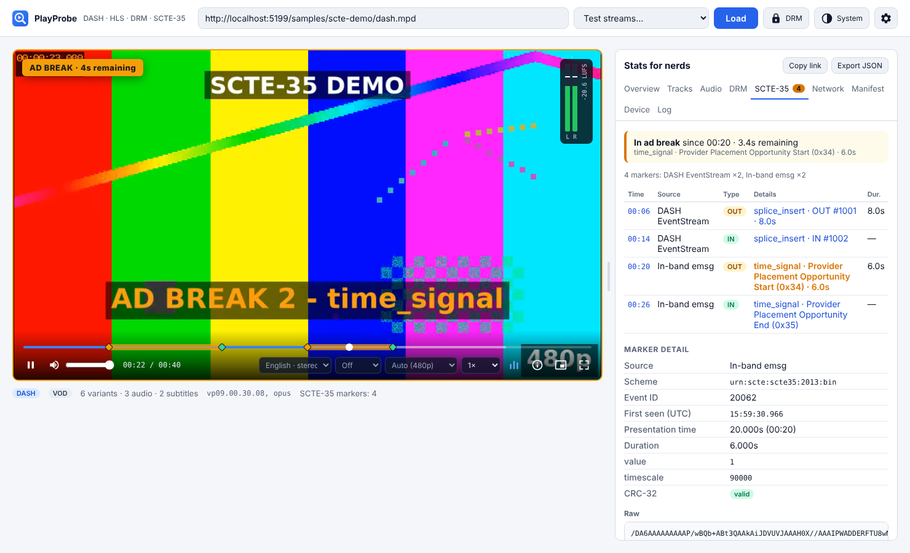

---

## Contents

- [Features](#features)
- [Quick start](#quick-start)
- [Playing HTTPS streams locally (CORS proxy)](#playing-https-streams-locally-cors-proxy)
- [Build and run in production](#build-and-run-in-production)
- [Deploy to Cloudflare Workers](#deploy-to-cloudflare-workers)
- [Screenshots](#screenshots)
- [SCTE-35 support](#scte-35-support)
- [Architecture](#architecture)
- [Project structure](#project-structure)
- [Testing](#testing)
- [The bundled sample stream](#the-bundled-sample-stream)
- [Keyboard shortcuts](#keyboard-shortcuts)
- [Troubleshooting](#troubleshooting)
- [Roadmap](#roadmap)

---

## Features

| Area | What you get |
| --- | --- |
| **Load a stream** | Paste any `.mpd` or `.m3u8` URL, or pick a test stream (bundled offline sample, public VOD, live). Recent URLs are remembered, and a `?url=` link opens the app with that stream loaded. |
| **Player controls** | Play/pause, a seek bar showing what's buffered and where the SCTE markers are, volume and mute, **audio track**, **subtitles**, **quality** (Auto or a fixed rendition), playback speed, picture-in-picture, fullscreen, and a jump-to-live button for live streams. |
| **Stats: Overview** | Format, live or VOD, latency, how far back you can rewind (live), wall-clock playhead, current rendition, codecs, frame rate, SDR or HDR, stream bitrate and estimated bandwidth, buffer, dropped frames, stalls, startup timings. Plus a live graph of bandwidth and buffer. |
| **Stats: Tracks** | Every video rendition, audio track (language, roles, codec, channels, sample rate), subtitle/caption track, thumbnail track and quality option, with the active ones highlighted. |
| **Stats: SCTE-35** | Every ad marker the app finds, with time, source, OUT/IN direction, a decoded summary and duration. Click a marker to see its full decoded contents and CRC check. Also shows whether you're **in an ad break right now** (with countdown), and includes a **manual decoder** for pasted base64 or hex messages. |
| **Stats: Network** | Every manifest, playlist and segment request: status, size, time, throughput, errors, and whether it went through the proxy. |
| **Stats: Manifest** | The raw MPD and every HLS playlist exactly as fetched (refreshes for live streams), with SCTE and ad-related lines highlighted. |
| **Stats: Device** | Codec support (Media Source Extensions plus a 1080p smoothness check), DRM support and security levels (Widevine, PlayReady, FairPlay, ClearKey), HDCP version, HDR display and colour range. |
| **Stats: Log** | Loading steps, quality switches, track changes, stalls and errors. |
| **Light / dark theme** | The header button cycles **System** (follows your OS setting), **Light** and **Dark**. The choice is remembered. The video area stays dark in both themes, as video players normally do. |
| **Resizable layout** | Drag the handle between the player and the stats panel: drag left for a wider stats panel and a smaller player, right for the opposite. The width is remembered. Double-click the handle to reset; with the handle focused, arrow keys also resize it. |
| **Stats overlay** | A compact YouTube-style "stats for nerds" box on top of the video (press `i`). |
| **Export** | Downloads a JSON file with the stats, tracks, SCTE log, network log and event log, useful to attach to a bug report. |
| **CORS proxy** | Built into the local dev and preview servers, so plain HTTPS streams play even when their server doesn't allow browser access (see below). |

---

## Quick start

**Prerequisites:** [Node.js](https://nodejs.org/) **22.12 or newer** (an `.nvmrc` is included) and npm.

```bash
git clone https://github.com/garghe/simple-abr-player.git
cd simple-abr-player
npm install
npm run dev
```

Open **http://localhost:5173**, paste a DASH or HLS URL and press **Load**. You can also pick a stream from the **Test streams…** menu. The two **Bundled sample** entries work fully offline and contain SCTE-35 markers.

You can also link straight to a stream:

```
http://localhost:5173/?url=https://storage.googleapis.com/shaka-demo-assets/angel-one/dash.mpd
```

### npm scripts

| Command | What it does |
| --- | --- |
| `npm run dev` | Starts the development server on port 5173, with live reload and the CORS proxy. |
| `npm run build` | Checks types, then builds the static site into `dist/`. |
| `npm run preview` | Serves the production build on port 4173, with the CORS proxy. |
| `npm test` | Runs the unit tests (Vitest). |
| `npm run typecheck` | Checks TypeScript types only. |
| `npm run sample` | Regenerates the bundled SCTE-35 sample (needs `ffmpeg`). |
| `npm run deploy` | Builds and deploys to Cloudflare Workers (after `npx wrangler login`). |
| `npm run screenshots` | Regenerates the README screenshots (needs Playwright's Chromium). |

---

## Playing HTTPS streams locally (CORS proxy)

Browsers only let a web page download a manifest from another site if that site allows it (CORS). Many origin servers and CDNs don't, especially internal or pre-production ones. To make **any plain HTTPS stream** play locally, the dev and preview servers include a small proxy:

```
Browser ──► http://localhost:5173/__proxy/https/cdn.example.com/live/master.m3u8
              │  (Vite server: fetches it, adds the CORS headers)
              ▼
            https://cdn.example.com/live/master.m3u8
```

The original URL structure is kept, so relative segment URLs inside the manifest still work. Absolute URLs (for example, segments on a different CDN) are rerouted through the proxy by the player.

Choose how it's used in **⚙ Settings → CORS proxy**:

| Mode | Behaviour |
| --- | --- |
| **Auto** (default) | Tries the stream directly first. If the manifest request fails (CORS or network error), it retries through the proxy automatically. The Overview tab shows which route was used. |
| **Always** | Every request goes through the proxy. Useful when the manifest allows browser access but the segments don't. |
| **Off** | Always fetches directly from the browser. |

Other details:

- **Corporate networks:** the proxy follows the standard `HTTPS_PROXY`, `HTTP_PROXY` and `NO_PROXY` settings. If your company inspects HTTPS traffic, also set `NODE_EXTRA_CA_CERTS=/path/to/corporate-ca.pem` before `npm run dev`.
- **Custom headers** (⚙ Settings) are added to every request, for example `Authorization: Bearer …` for tokenised origins. They are passed on through the proxy too.
- **Redirects** are followed, and byte-range requests work (needed for single-file DASH streams).
- **Security:** the proxy is for **local use only**. Vite listens only on `localhost` by default. Don't run it with `--host` on a shared network, because anyone who can reach it could use it to fetch URLs from your machine.

> A plain static deployment (for example GitHub Pages) has **no proxy**, so streams must allow browser access (CORS). The [Cloudflare Workers deployment](#deploy-to-cloudflare-workers) can run the same proxy online if you switch it on. A site served over `https://` also can't load `http://` streams (the browser blocks mixed content), unless they go through the proxy.

---

## Build and run in production

```bash
npm run build      # → dist/
npm run preview    # serves dist/ on http://localhost:4173, with the CORS proxy
```

`dist/` is a fully static site with relative paths (`base: './'`), so you can host it from any web server, bucket or sub-folder: GitHub Pages, S3 + CloudFront, nginx, and so on. A plain static host has no CORS proxy (see above). For a hosted version *with* the proxy, use Cloudflare Workers (next section).

---

## Deploy to Cloudflare Workers

The repo is ready for [Cloudflare Workers](https://developers.cloudflare.com/workers/). Workers serves the built site (`dist/`) as static files, and a small Worker script (`worker/index.ts`) can also run the CORS proxy online. Configuration lives in [`wrangler.jsonc`](wrangler.jsonc).

### Option A: connect the GitHub repo (recommended)

In the Cloudflare dashboard go to **Workers & Pages → Create → Import a repository**, choose **garghe/simple-abr-player** and fill in the form:

| Field | Value |
| --- | --- |
| Repository | `garghe/simple-abr-player` |
| Project name | `simple-abr-player` (must match `"name"` in `wrangler.jsonc`) |
| Build command | `npm run build` |
| Deploy command | `npx wrangler deploy` |
| Preview command | `npx wrangler preview` |
| Enable Preview builds | **On**: each non-production branch or pull request gets its own preview URL |
| Protect with Cloudflare Access | **Off** for a public player. Turn it **on** if you enable the proxy without a host allowlist (see below). |

Under **Advanced settings → Build variables**, nothing is required. The build uses Node 22 from `.nvmrc`. If your build image ignores `.nvmrc`, add `NODE_VERSION` = `22`.

**Production branch:** Cloudflare deploys the repository's default branch, currently `claude/brave-brown-gye24p` (the only branch). After you merge into `main`, change it in **Settings → Build → Branch control**.

Press **Deploy**. The app will be available at `https://simple-abr-player.<your-subdomain>.workers.dev`. Every push to the production branch redeploys it automatically.

### Option B: deploy from your computer

```bash
npx wrangler login     # once, opens the browser
npm run deploy         # = npm run build && wrangler deploy
```

### Turning on the CORS proxy online (optional)

The proxy is **off by default** on Cloudflare: a public, open proxy could be used by anyone to fetch anything through your account. With it off, the app works but streams must allow browser access (CORS). The app detects this and does not offer the proxy.

To turn it on, set these variables in **Worker → Settings → Variables and Secrets** (or in `wrangler.jsonc` under `"vars"`), then redeploy:

| Variable | Value | Meaning |
| --- | --- | --- |
| `PROXY_ENABLED` | `true` | Turns `/__proxy/…` on. |
| `PROXY_ALLOWED_HOSTS` | e.g. `*.akamaized.net,cdn.example.com` | Comma-separated origin hosts the proxy may fetch (`*.` matches subdomains). **Strongly recommended.** Other hosts get `403`. Empty means any host, so only leave it empty with **Protect with Cloudflare Access** turned on, so that only people you allow can use the site. |
| `PROXY_SEGMENTS` | `false` (default) | **Segment guardrail.** Only manifests and playlists go through the Worker; video, audio, subtitle and init segments are always fetched directly by the browser. Set `true` only if the segment CDN itself blocks CORS (then every segment costs one Worker request). |

> **Note:** variables set in the dashboard are overwritten by the values in `wrangler.jsonc` on the next deploy from Git. To keep dashboard values, either edit `wrangler.jsonc` in the repo (recommended), or remove the `"vars"` block.

Things to know when the proxy is on:

- **Request usage is kept low by the segment guardrail.** Each proxied request counts towards your [Workers request limits](https://developers.cloudflare.com/workers/platform/limits/) (free plan: 100,000 per day). With `PROXY_SEGMENTS=false` the proxy only carries manifests and playlists:
  - **VOD:** a handful of requests per stream (the manifest and, for HLS, its playlists).
  - **Live DASH:** one request per manifest refresh.
  - **Live HLS:** one request per playlist refresh, about one per segment duration for each active playlist (video + audio). That's roughly 1,200–3,600 per hour, so live HLS through the proxy is the case that still uses requests.
- How the guardrail works, in two layers:
  1. **In the player:** `/__proxy/health` reports `"segments": false`, so the player routes only manifests and playlists through the proxy. Segments, including ones whose relative URLs point into the proxy, are sent directly to the CDN.
  2. **In the Worker:** if a segment request arrives anyway, it's refused with `403` before anything is fetched (checked by file extension, then by response `Content-Type`).
- **When it bites:** if the segment CDN also blocks CORS, the segments fail and the **Log** tab explains it, naming the host. Fix it with CORS on that CDN (best), `npm run dev` locally, or `PROXY_SEGMENTS=true`.
- Keep the app on **Auto** mode, which only uses the proxy when a direct request fails. Streams that already allow browser access then use no Worker requests at all.
- The local `npm run dev` proxy has no such limits and proxies segments too.
- The Worker fetches from Cloudflare's network, not your office network, so origins that are only reachable internally (VPN or private IPs) still need the local `npm run dev` proxy.

### Checking a deployment

| URL | Expected |
| --- | --- |
| `https://<your-worker>/` | The player |
| `https://<your-worker>/samples/scte-demo/dash.mpd` | The bundled sample MPD |
| `https://<your-worker>/__proxy/health` | `{"status":"ok","kind":"cloudflare","segments":false}` when the proxy is on; `404 disabled` when off |
| `https://<your-worker>/__proxy/https/<host>/<path>/seg.m4s` | `403` while `PROXY_SEGMENTS` is `false` (guardrail working) |

To try the Worker locally with the same runtime Cloudflare uses: `npm run build && npx wrangler dev`. Add `--var PROXY_ENABLED:true` to test the proxy.

---

## Screenshots

> Captured with `npm run screenshots` in **headless Chromium**. That browser has no H.264/AAC codecs and no DRM, which is why the Device tab shows them as unsupported. In regular Chrome, Edge or Safari they show as supported.

**SCTE-35 tab during an ad break (DASH sample)**: ad-break banner on the video, markers and break regions on the seek bar, the marker list, and the decoded detail of an in-band `time_signal`.


**Overview with the stats overlay (`i`)**: stream and playback stats, plus the bandwidth and buffer graph.
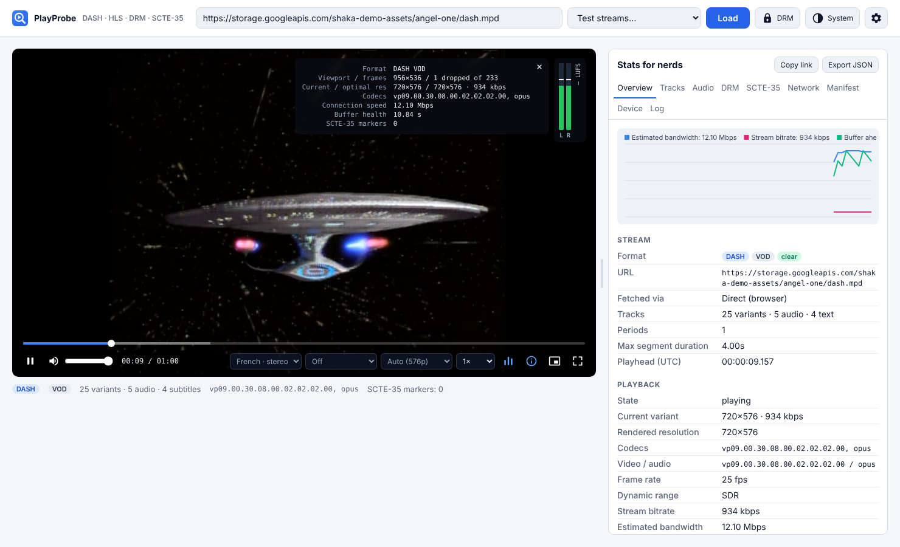

**Tracks**: video renditions, audio and subtitle tracks (subtitles shown on the video).
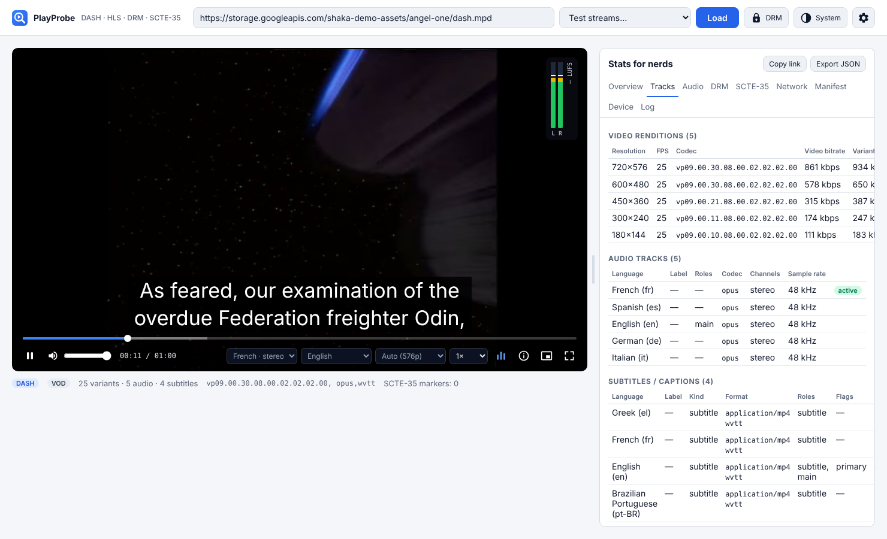

**Manifest (HLS sample)**: the raw media playlist with `EXT-X-DATERANGE`, `CUE-OUT`, `CUE-OUT-CONT` and `CUE-IN` highlighted.
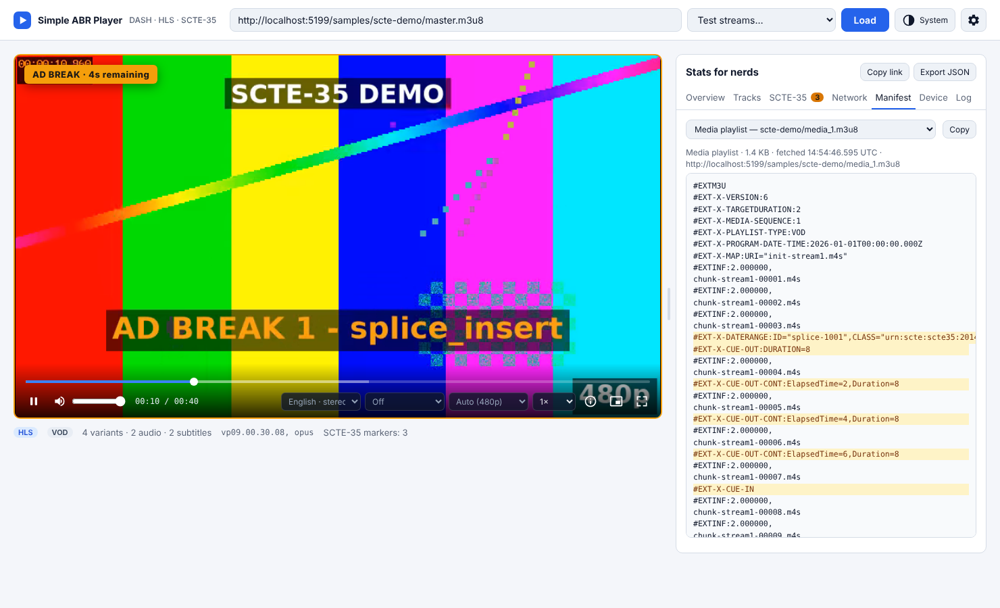

**Network**: every request with status, size, time and throughput.
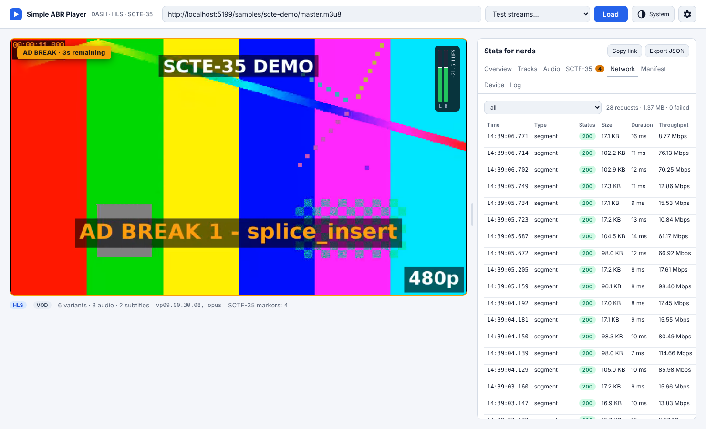

**Device**: codec, DRM and display capabilities.
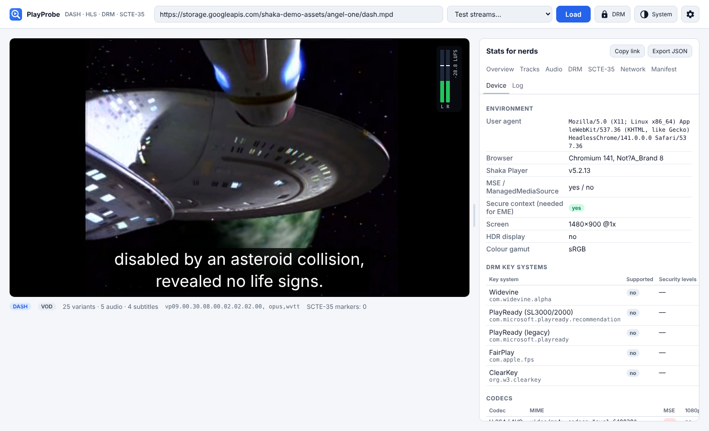

**Settings and Log**: CORS proxy mode, custom headers, low-latency mode.
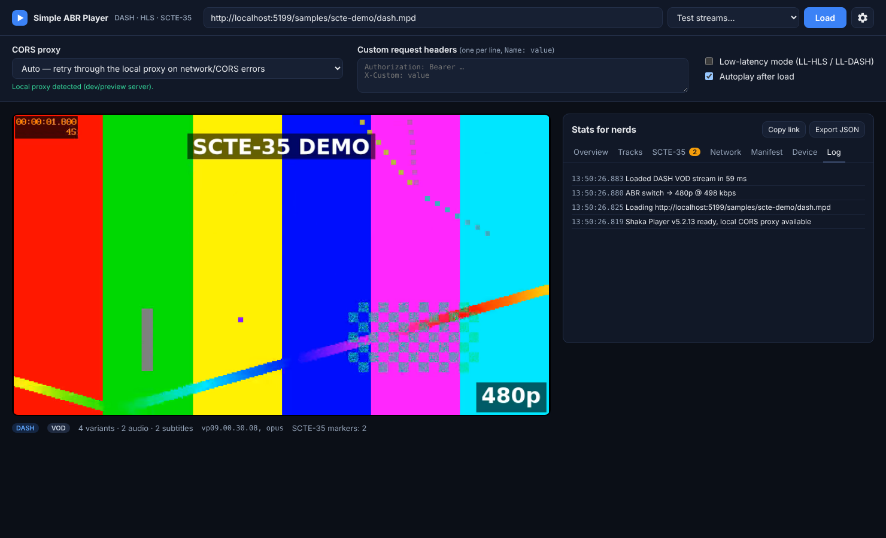

**Light theme**: the same view with the theme button set to Light.
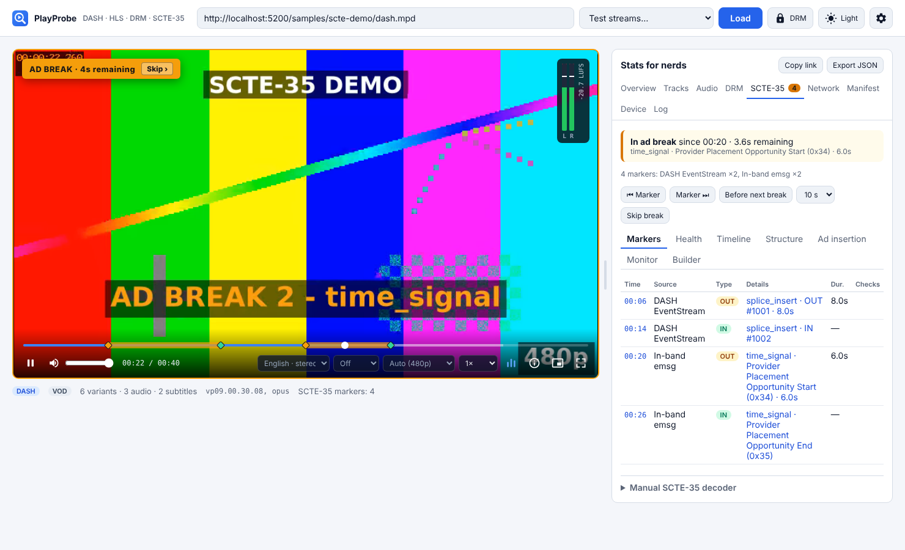

**Phone layout**: controls sit under the video; the stats panel stacks below.

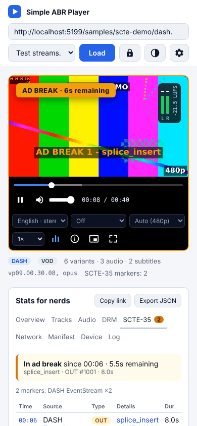

---

## SCTE-35 support

The app looks for markers in every common way they are carried. Duplicates are removed, because the same marker appears in every audio and video playlist and again on every live refresh.

| Format | Where the marker is carried | How it's detected |
| --- | --- | --- |
| DASH | In the MPD, as an `<EventStream>` (`urn:scte:scte35:2013:xml`, `2014:xml+bin`), with the message in `<Binary>` | The player's timeline events. The message is decoded; XML-only events are summarised. |
| DASH and HLS (fMP4) | Inside the video segments, as `emsg` boxes (`urn:scte:scte35:2013:bin`) | The player's `emsg` events, with every `emsg` box reported. |
| HLS | `#EXT-X-DATERANGE` with `SCTE35-OUT`, `SCTE35-IN` or `SCTE35-CMD` | The app reads every playlist itself. |
| HLS | `#EXT-X-CUE-OUT`, `#EXT-X-CUE-OUT-CONT`, `#EXT-X-CUE-IN` | Same. If you join a live stream mid-break, `CUE-OUT-CONT` is used to work out when the break started. |
| HLS | `#EXT-X-SCTE35:CUE="…"`, `#EXT-OATCLS-SCTE35:…`, `#EXT-X-SPLICEPOINT-SCTE35:…` | Same. |

The decoder (`src/scte/scte35.ts`) recognises every splice command (`splice_null`, `splice_insert`, `time_signal`, `splice_schedule`, `bandwidth_reservation`, `private_command`). It fully decodes `splice_insert` and `time_signal` (the commands used for ad signalling) and these descriptors (`avail`, `DTMF`, `segmentation` with all segmentation types and UPID types, `time`). It also checks the message's CRC. It accepts base64 or hex. Encrypted messages are flagged but not decrypted.

An ad break counts as **active** from an OUT marker (splice_insert with out-of-network set, or a segmentation type that starts an ad or placement opportunity) until its advertised duration runs out or an IN marker arrives.

---

## Architecture

The app is plain TypeScript with no UI framework, built with **Vite**. Playback uses **[Shaka Player](https://github.com/shaka-project/shaka-player)**: one engine for both DASH and HLS, and one that already supports Widevine, PlayReady and FairPlay for the DRM iteration.

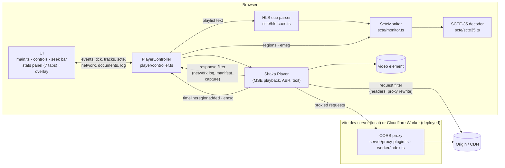

### Main parts

| Module | Responsibility |
| --- | --- |
| `src/player/controller.ts` | **The only code that talks to Shaka Player.** Loads streams (including the automatic retry through the proxy), applies custom headers and proxy rewriting to every request, keeps the network log and fetched manifests, collects SCTE events, converts HLS marker times to player times, samples the stats every second, and keeps the event log. Notifies the UI through simple events (`tick`, `tracks`, `scte`, `network`, `documents`, `log`, `loaded`, `error`). |
| `src/player/proxy.ts` | Converts URLs to and from their proxied form, and checks whether the proxy is available. |
| `server/proxy-shared.ts` | Proxy rules shared by the local server and the Worker: URL mapping, which headers are passed through, CORS headers, redirect rewriting, host allowlist, segment detection and the `/health` capability format. |
| `worker/index.ts` | Cloudflare Worker: serves the built site and, when `PROXY_ENABLED` is `true`, runs the CORS proxy (limited to `PROXY_ALLOWED_HOSTS`, and to manifests/playlists unless `PROXY_SEGMENTS` is `true`). |
| `server/proxy-plugin.ts` | Adds the CORS proxy to the Vite dev and preview servers. Passes ranges, headers and redirects through, and follows the HTTPS proxy settings. |
| `src/scte/scte35.ts` | SCTE-35 decoder, CRC check, summaries, and out/in and duration helpers. No dependencies; unit-tested against published sample messages. |
| `src/scte/hls-cues.ts` | Finds ad-marker tags in HLS playlists and links each one to its segment, timestamp and position. |
| `src/scte/monitor.ts` | Merges markers from all sources, removes duplicates, fills in timings that arrive later, and works out whether an ad break is active. |
| `src/ui/controls.ts`, `seekbar.ts` | Control bar, track selectors, keyboard shortcuts, and the seek bar with buffered regions and SCTE markers and breaks. |
| `src/ui/stats/*` | One file per tab. Only the visible tab updates (at most once per animation frame). |
| `src/ui/splitter.ts` | Drag handle that resizes the stats panel against the player (mouse, touch, keyboard), remembered in browser storage. |
| `src/ui/theme.ts` | System / Light / Dark toggle. Colours are CSS custom properties switched by `data-theme` on `<html>` (or the OS setting in System mode); a small inline script in `index.html` applies the saved theme before the page first appears. |
| `src/ui/chart.ts` | Small canvas line chart for bandwidth and buffer. |
| `src/settings.ts`, `src/presets.ts` | Saved settings and URL history (in browser storage, with safe fallbacks), and the list of test streams. |

### How an HLS SCTE marker reaches the UI

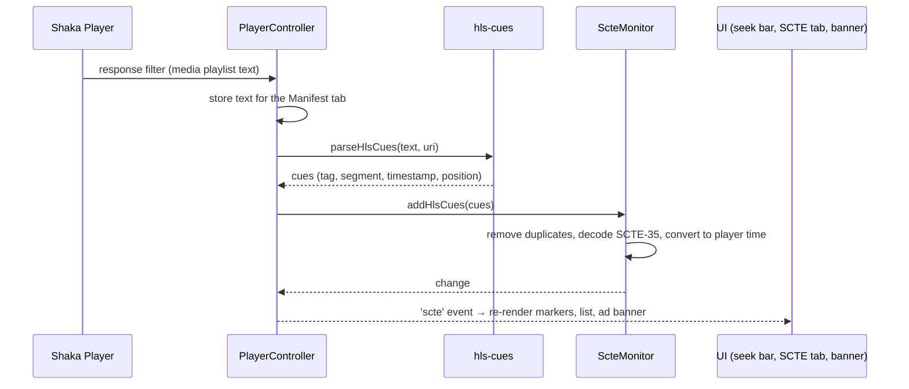

### Design choices

- **Shaka Player rather than hls.js + dash.js:** one engine and one set of track and stats APIs for both formats, and its DRM support carries over directly to the next iteration.
- **The app reads HLS playlists itself:** Shaka only reports `EXT-X-DATERANGE`, and only when the playlist has `PROGRAM-DATE-TIME`. Reading the playlist text catches every tag style, and costs nothing extra because it reuses the responses Shaka already downloaded.
- **Proxy that keeps the URL path:** relative URLs in the manifest keep working without rewriting the manifest, and the same approach works for every request type.
- **No UI framework:** keeps the app small and quick to load. Each part is a plain class with a `render()` method.

---

## Project structure

```
├── index.html                 Page layout (header, settings, player, stats panel)
├── vite.config.ts             Vite + CORS proxy plugin + Vitest config
├── wrangler.jsonc             Cloudflare Workers config (assets, proxy variables)
├── worker/
│   └── index.ts               Cloudflare Worker: static site + optional CORS proxy
├── server/
│   ├── proxy-shared.ts        Proxy logic shared by Vite plugin and Worker
│   └── proxy-plugin.ts        Local CORS proxy (dev + preview)
├── src/
│   ├── main.ts                Connects everything: load, settings, overlay, export, share
│   ├── player/                PlayerController (Shaka wrapper), proxy URL helpers
│   ├── scte/                  SCTE-35 decoder, HLS cue parser, marker monitor
│   ├── ui/                    Controls, seek bar, chart, helpers
│   │   └── stats/             Overview, Tracks, SCTE-35, Network, Manifest, Device, Log tabs
│   ├── presets.ts             Test stream list
│   ├── settings.ts            Saved settings / history
│   └── styles.css
├── public/samples/scte-demo/  Bundled offline DASH + HLS sample with SCTE-35
├── scripts/
│   ├── make-sample.mjs        Builds the sample with ffmpeg + adds SCTE-35 markers
│   ├── screenshots.mjs        Regenerates docs/screenshots with Playwright
│   └── lib/scte35-encode.mjs  Minimal SCTE-35 encoder (sample + tests)
├── test/                      Vitest unit tests
└── docs/screenshots/          README images
```

---

## Testing

```bash
npm test           # unit tests
npm run typecheck  # TypeScript only
```

The unit tests cover:

- **SCTE-35 decoding** against published sample messages (`time_signal` with a Placement Opportunity Start; `splice_insert` with a break duration and avail descriptor), round trips with the encoder, CRC checks, and invalid input.
- **HLS tag parsing**: attribute lists, DATERANGE, CUE-OUT/CONT/IN and OATCLS, segment and timestamp linking, VOD vs live.
- **Marker monitor**: duplicate removal across playlists and refreshes, active-break detection, and joining a live stream mid-break.
- **Proxy URL conversion**: round trips, relative URLs, how the server reads the target URL, and the host allowlist.
- **Cloudflare Worker**: static files passed through, proxy off by default, health check and capabilities, CORS and Range/custom header forwarding, redirect rewriting, allowlist blocking, and the segment guardrail (blocked by extension without contacting the origin, blocked by Content-Type, playlists still allowed, `PROXY_SEGMENTS=true` override).
- **Request routing**: manifests proxied, segments sent directly, relative segment URLs taken back out of the proxy, own-site files never proxied.

For end-to-end checks, `npm run screenshots` drives the real app in Chromium against both bundled samples. It's a quick smoke test for DASH, HLS, SCTE detection and the UI.

---

## The bundled sample stream

`public/samples/scte-demo/` contains a 40-second sample that works offline, made by `npm run sample` (needs `ffmpeg` with VP9 and Opus support):

- VP9 video at 240p and 480p, two Opus audio tracks (English and Italian), English and Italian WebVTT subtitles.
- The same segments are used by `dash.mpd` and by the HLS `master.m3u8`.
- SCTE-35 markers:
  - **6 s → 14 s:** `splice_insert` OUT (8 s) and IN, in a DASH `<EventStream>` / HLS `EXT-X-DATERANGE SCTE35-OUT` + `CUE-OUT` / `CUE-OUT-CONT` / `CUE-IN`.
  - **20 s → 26 s:** `time_signal` with a segmentation descriptor (Provider Placement Opportunity Start/End, Ad-ID UPID), as **in-band `emsg`** boxes in the video segments (both DASH and HLS).

VP9/Opus is used so the sample also plays in open-source Chromium, which is used for the automated screenshots.

---

## Keyboard shortcuts

| Key | Action |
| --- | --- |
| `Space` / `k` | Play / pause |
| `←` / `→` | Seek −5 s / +5 s |
| `↑` / `↓` | Volume up / down |
| `m` | Mute |
| `c` | Cycle subtitles |
| `f` | Fullscreen |
| `i` | Stats overlay on the video |
| `l` | Jump to live edge |

---

## Troubleshooting

| Symptom | Likely cause and fix |
| --- | --- |
| `Shaka error 1002 HTTP_ERROR` | Usually CORS or a network failure. With `npm run dev`, set the proxy to **Auto** or **Always**. Check the **Network** tab for the failing URL and status. |
| `4032 CONTENT_UNSUPPORTED_BY_BROWSER` | The browser can't decode those codecs (for example HEVC in Firefox, or H.264 in headless Chromium). The **Device** tab shows what this device supports. |
| `6001` / `6007` (DRM) | The stream is encrypted. DRM comes in the next iteration. |
| Nothing plays from a deployed `https://` site | The stream is `http://` (blocked as mixed content) or doesn't allow browser access. Run locally with `npm run dev`. |
| Proxy can't reach the origin behind a corporate proxy | Set `HTTPS_PROXY` (and `NODE_EXTRA_CA_CERTS` if your company inspects HTTPS) before `npm run dev`. |
| On Cloudflare, a stream fails with a CORS error and the app doesn't offer the proxy | The proxy is off on the Worker. Set `PROXY_ENABLED=true` (and `PROXY_ALLOWED_HOSTS`), then redeploy. Check with `/__proxy/health`. |
| On Cloudflare the manifest loads but segments fail; the Log says *"This proxy only carries manifests/playlists"* | The segment CDN blocks CORS. Enable CORS on that CDN, use `npm run dev`, or set `PROXY_SEGMENTS=true` (one Worker request per segment). |
| Proxy returns `403 … not in PROXY_ALLOWED_HOSTS` | Add the origin's host (or `*.domain`) to `PROXY_ALLOWED_HOSTS`. |
| `npm run screenshots` can't find a browser | Run `npx playwright install chromium`, or set `CHROMIUM_PATH` to a Chrome or Chromium executable. |

---

## Roadmap

- **DRM (next iteration):** license server URLs per key system, license request headers, FairPlay certificate, and DRM session and key status in the stats panel. Builds on Shaka's DRM support and the existing Device tab.
- Thumbnail previews on the seek bar.
- Low-latency stats (part and chunk timing, playback-rate catch-up).
- CMCD / CMSD reporting and inspection.
- A timeline view of SCTE breaks against playback and quality switches.
